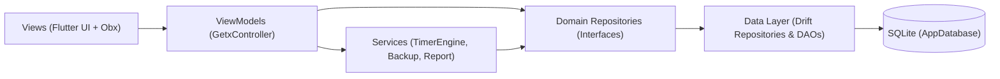

<div align="center">
  
  <h1>ParhaiMate</h1>
  <p><strong>Your Personal Study Companion</strong> — a calm, 100% offline-first study timer, planner, and progress tracker built with Flutter.</p>
  <p>
    
    
    
    
    
  </p>
</div>

---

## Overview

**ParhaiMate** is an offline-first Android study productivity application designed around visual clarity, zero clutter, and deterministic timekeeping. Every study session, subject, planned task, streak record, preset, and achievement lives locally in an encrypted-safe on-device SQLite database powered by **Drift**, with portable **JSON backups** and **PDF/CSV study reports**.

### Guiding Principles
- **Strict Monochrome & Navy Visual Language:** Pure white canvases (`#FFFFFF`), black primary typography (`#000000`), neutral grey surfaces (`#F0F0F0`), subtle borders (`#E4E4E4`), and deep navy accents (`#123B52`) — zero distracting bright colors, gradients, or dark-mode overrides.
- **Zero-Friction Studying:** Subjects are optional on every session (`subjectId` is nullable), letting you launch Focus, Stopwatch, or Pomodoro timers immediately.
- **Resilient Timestamp-Based Timing:** Active timer states persist in SQLite (`active_timer_states`) using wall-clock timestamps (`startedAt`, `targetEndAt`, `accumulatedSeconds`), surviving app pauses, screen locks, and relaunches accurately.
- **100% Offline & Private:** Zero cloud accounts, zero telemetry, zero notification permissions (`POST_NOTIFICATIONS` omitted by design). Your data stays on your device.

---

## Key Features

### 1. Launch & Onboarding
- **Branded Splash (`SplashView`):** Features the ParhaiMate emblem (`assets/app-icon.png`), animated progress dots, and Coding District footer attribution, routing cleanly to Onboarding (first launch), Home Dashboard, or recovering an interrupted Active Focus session.
- **3-Slide Onboarding (`OnboardingView`):** Custom monochrome/navy `CustomPainter` illustrations introducing focused studying, routine planning, and measurable progress, with skip support.

### 2. Home Dashboard & Main Shell
- **4-Tab Shell (`MainShellView`):** Persistent bottom navigation across **Home**, **Timer**, **Subjects**, and **Progress**, plus a live banner whenever an active study session is running or paused in the background.
- **Dashboard (`HomeView`):** Dynamic time-of-day greeting, 7-day horizontal week date strip with activity dots, circular daily goal progress ring, 3-column summary stats (Today Studied, Active Streak, Weekly Progress), quick-start actions, today's scheduled tasks with instant completion toggles, recent activity feed, and clean empty states.

### 3. Study Timer & Focus Workflow
- **Three Timer Modes (`StudyTimerView` & `SessionSetupView`):**
  - **Focus Timer:** Configurable countdown duration (preset chips + custom duration), live `Planned time` and dynamic `Ends at` calculation.
  - **Stopwatch:** Open-ended count-up session showing `No time limit` with real-time pause/resume segment tracking.
  - **Pomodoro:** Configurable Focus block, Short break, Long break, and Cycles before long break with automatic phase transitions.
- **Active Focus Mode (`ActiveFocusView`):** Real-time updating clock (`500ms` ticker synced to wall clock), elapsed/phase indicators, pause/resume controls, minimize-to-banner action, and confirmation dialogs before finishing or canceling.
- **Session Summary (`SessionSummaryView`):** Post-session breakdown (Subject, Mode, Start/End times, Duration), inline **Add Notes** bottom sheet, and quick **Save Session** / **Start Another Session** / **Back to Home** actions.

### 4. Subjects & Subject Analytics
- **Subject Management (`SubjectsView`):** Real-time search bar, Active vs. Archived tabs, weekly target progress bars, and empty/no-results states.
- **Subject Form (`AddEditSubjectView`):** Supports 12 monochrome domain icons (`SubjectIconKey`) and 5 geometric monochrome identifiers (`Circle`, `Square`, `Triangle`, `Diamond`, `Ring`), weekly goal steppers, inline validation, archive/restore toggle, and cascade-aware delete confirmation.
- **Subject Details (`SubjectDetailsView`):** Weekly `fl_chart` bar chart, total/weekly study stats, filtered session history, and quick actions sheet.

### 5. Study Planner & Calendar
- **Study Planner (`StudyPlannerView`):** Interactive week strip with `Today`, `Upcoming`, and `Completed` views, task checkboxes with instant updates, and subject tags.
- **Add/Edit Task (`AddEditTaskView`):** Date picker sheet, optional time slot, target duration stepper, optional notes, validation, delete confirmation, and direct **Start Studying** launch into Session Setup.
- **Monthly Calendar (`CalendarView`):** Full month grid with **Studied** and **Planned** activity dots, month/year selector sheet, and per-day study + task summary cards.

### 6. Progress — Statistics, History, Goals & Achievements
- **Statistics (`StatisticsView`):** Week / Month / Year timeframe switcher backed by `fl_chart` visualizations (daily activity bar chart, subject distribution donut chart, and trend line chart), insights summary, and clean empty-activity fallback.
- **Session History (`SessionHistoryView`):** Filterable by subject chips and sortable by date/duration, grouped chronologically.
- **Goals & Streaks (`GoalsStreaksView`):** Daily circular ring, weekly bar progress, current & longest streak metrics, 28-day study consistency heatmap, and quick goal adjustments.
- **Achievements (`AchievementsView`):** 6 milestone badges (`First Step`, `Focus Starter`, `Consistent Learner`, `Study Champion`, `Time Master`, `Weekly Warrior`) with live progress bars and locked/unlocked detail sheets.

### 7. Settings, Presets, Offline Backup & Study Reports
- **Settings (`SettingsView`):** Grouped configuration for Daily/Weekly Study Goals, Default Timer Mode sheet, Timer Presets, Export/Import Backup, Export Study Report, About ParhaiMate, Privacy Policy, Clear Study History, and typed-`DELETE` Data Reset.
- **Goal Configuration (`DailyGoalConfigView`, `WeeklyGoalConfigView`):** Numeric steppers + quick hour preset chips (`1h–6h` daily, `10h–30h` weekly) with live comparison banners.
- **Timer Presets (`PresetsListView`, `PresetFormView`):** Seeded presets (`Classic Pomodoro`, `Deep Work`, `Quick Review`) plus custom CRUD with dynamic total-session calculation across Focus, Pomodoro, and Stopwatch modes.
- **Offline JSON Backup (`BackupService`, `ExportBackupView`, `ImportBackupView`):**
  - Exports complete study data (`schemaVersion`, settings, subjects, sessions, tasks, presets, daily goals, streaks, achievements — excluding transient `activeTimerStates`) via Android's native **Save As** Storage Access Framework picker (`FilePicker.saveFile`) directly to **Downloads** or any chosen folder, plus **Share File** support.
  - Validates `.json` extension and document integrity cleanly (`"Couldn't read this file"` / `"This backup is damaged"`).
  - Supports **Replace current data** (transactional wipe + restore) and **Merge with current data** (deduplicated merge + automatic `dailyGoals` and `streakRecords` conflict reconciliation).
- **Study Report Export (`ReportService`, `ExportReportView`):** Period-filtered (`This week`, `This month`, `All time`) report generator producing crisp monochrome/navy **PDF** documents (`package:pdf`) and spreadsheet-ready **CSV** logs (`package:csv`) with system share integration.

---

## Design System

All UI components live in `lib/core/theme/` and `lib/core/widgets/`:

| Token | Hex | Usage |
| :--- | :--- | :--- |
| `background` | `#FFFFFF` | Primary scaffold & screen canvas |
| `card` | `#FFFFFF` | Elevated/bordered content cards & bottom sheets |
| `surface` | `#F0F0F0` | Grey summary cards, segmented tracks, icon badges |
| `primary` | `#123B52` | Primary CTAs, active chips/nav, progress bars & charts |
| `foreground` / `destructive` | `#000000` | Headings, primary text, destructive confirmation buttons |
| `textSecondary` | `#5C5C5C` | Subtitles, metadata, inactive labels |
| `textMuted` | `#8A8A8A` | Hints, timestamps, subtle chevrons |
| `border` | `#E4E4E4` | 1px card, input & bottom-nav outlines |
| `divider` | `#EDEDED` | List row dividers |
| `track` | `#DCDCDC` | Unfilled progress bars & chart tracks |
| `disabled` | `#C8C8C8` | Disabled primary/destructive buttons |

---

## Architecture & Project Structure

ParhaiMate follows a **feature-first MVVM architecture** using **GetX** (`GetxController`, `GetView`, `BindingsBuilder`, `GetMaterialApp`) paired with a clean **Domain / Data repository layer** backed by **Drift SQLite**.



```text
lib/
├── main.dart                         # App entry point (WidgetsFlutterBinding + ParhaiMateRootApp)
├── app/
│   ├── app.dart                      # GetMaterialApp root configuration & light theme
│   ├── bindings/initial_binding.dart # Permanent core DI (DB, 7 repositories, TimerEngine, Backup/Report)
│   ├── lifecycle/                    # AppLifecycleHandler syncing timer state on resume/pause
│   └── routes/                       # AppRoutes (31 named routes) & AppPages GetX bindings
├── core/
│   ├── services/                     # TimerEngineService (timestamp timer state machine)
│   ├── theme/                        # AppColors, AppTypography, AppSpacing, AppRadii, AppTheme
│   ├── utils/                        # DateTimeUtils & formatting helpers
│   └── widgets/                      # Reusable Pm* components (Buttons, Inputs, Cards, Feedback, Progress, Nav)
├── data/
│   ├── database/
│   │   ├── app_database.dart         # Drift DB (10 tables, 8 DAOs, schema v1 seeding, FK enforcement)
│   │   ├── tables/                   # Subjects, StudySessions, DailyGoals, PlannerTasks, TimerPresets, etc.
│   │   ├── daos/                     # Strongly typed reactive Watch/CRUD DAOs
│   │   └── migrations/               # DatabaseMigrations & performance indexes
│   └── repositories/                 # Drift-backed repository implementations
├── domain/
│   ├── entities/                     # Immutable pure-Dart domain entities
│   ├── enums/                        # TimerMode, TimerPhase, SubjectIdentifier, SubjectIconKey, BackupRestoreMode
│   └── repositories/                 # Abstract repository interfaces
├── features/
│   ├── onboarding/                   # Splash, Onboarding (3 slides), ParhaiMateLogo, illustrations
│   ├── home/                         # MainShell (4 tabs + active timer banner), HomeDashboard
│   ├── timer/                        # StudyTimer, SessionSetup, ActiveFocus, SessionSummary
│   ├── subjects/                     # MySubjects, SubjectDetails, AddEditSubject
│   ├── planner/                      # StudyPlanner, AddEditTask
│   ├── calendar/                     # Monthly Calendar + day detail view
│   ├── statistics/                   # Statistics (fl_chart), SessionHistory
│   ├── goals/                        # GoalsStreaks (28-day heatmap + steppers)
│   ├── achievements/                 # 6 study milestones & detail sheets
│   ├── settings/                     # Settings, GoalConfig, TimerPresets, PrivacyPolicy, ComponentLibrary
│   └── backup/                       # BackupService, ReportService, ExportBackup, ImportBackup, ExportReport
└── shared/
    ├── enums/                        # SubjectVisuals UI icon/shape mapping
    └── widgets/                      # Shared domain cards & PoweredByCodingDistrict branding
```

### Local SQLite Schema (Drift — Schema v1)
10 Drift tables managed across 8 DAOs with `PRAGMA foreign_keys = ON`:
- `Subjects` — Subject catalog, icon/shape keys, weekly targets, archive flag
- `StudySessions` — Completed/cancelled focus logs (nullable `subjectId` with cascade delete), mode, timestamps, duration, notes
- `SessionEvents` — Pause/resume/phase audit events per session
- `ActiveTimerStates` — Single-row crash/background-safe running timer state
- `PlannerTasks` — Date-keyed tasks with optional time slots, target minutes, and completion status
- `DailyGoals` — Date-scoped daily study targets
- `StreakRecords` — Daily minutes and streak qualification index
- `TimerPresets` — Reusable Focus / Stopwatch / Pomodoro templates (seeded with 3 defaults)
- `Achievements` — Unlock timestamps for the 6 core study milestones
- `AppSettings` — Key-value store (`daily_goal_minutes`, `weekly_goal_minutes`, `default_timer_mode`, `onboarding_completed`)

---

## Tech Stack & Dependencies

| Package | Version | Purpose |
| :--- | :--- | :--- |
| `get` | `^4.7.3` | State management (`Rx` / `Obx`), DI (`Bindings`), and named routing |
| `drift` & `sqlite3_flutter_libs` | `^2.31.0` / `^0.5.42` | Type-safe reactive SQLite persistence & migrations |
| `fl_chart` | `^1.3.1` | Bar, donut, and line study analytics charts |
| `pdf` | `^3.12.0` | Offline printable A4 PDF study report generation |
| `csv` | `^6.0.0` | CSV session data serialization |
| `file_picker` | `^11.0.3` | Native Android SAF **Save As** & **.json** file selection |
| `share_plus` | `^12.0.2` | Native system file sharing for backups and study reports |
| `path_provider` & `path` | `^2.1.5` / `^1.9.1` | Local database & temporary export file path resolution |
| `intl` | `^0.20.3` | Locale-safe date and clock formatting |
| `drift_dev` & `build_runner` | `^2.31.0` / `^2.15.1` | Drift table & DAO code generation |
| `flutter_lints` | `^5.0.0` | Static analysis & lint enforcement |

---

## Getting Started

### Prerequisites
- **Flutter SDK** (Dart SDK `^3.9.2`)
- **Android Studio / Android SDK** (for building or running on an Android emulator/device)

### Setup & Run
```bash
# 1. Install dependencies
flutter pub get

# 2. (Optional) Regenerate Drift database code after schema edits
dart run build_runner build --delete-conflicting-outputs

# 3. Run the app on a connected Android device or emulator
flutter run
```

### Build Android APK
```bash
flutter build apk --debug
# Output: build/app/outputs/flutter-apk/app-debug.apk
```

---

## Testing & Verification

The project includes **12 test suites (46 automated unit, widget, database, and end-to-end integration tests)** covering every layer and screen:

| Test File | Scope |
| :--- | :--- |
| `test/stage1_foundation_test.dart` | Dependency hygiene (no notifications), AndroidManifest, backup rules, root scaffold |
| `test/stage2_design_system_test.dart` | Strict color/typography tokens & reusable `Pm*` component library |
| `test/stage3_database_test.dart` | Drift seeding, foreign keys, nullable subjects, streaks, single-row active timer |
| `test/stage4_timer_and_domain_test.dart` | Timestamp countdown, pause/resume stopwatch, Pomodoro cycles, streak calculation |
| `test/section5_1_onboarding_test.dart` | Splash auto-routing, 3-slide onboarding, Coding District branding, component library |
| `test/section5_2_home_dashboard_test.dart` | Empty & populated Home Dashboard, task toggle, 4-tab navigation |
| `test/section5_3_timer_sessions_test.dart` | Unassigned session start, mode setup, 1-second live clock ticks, summary & notes |
| `test/section5_4_subjects_test.dart` | Subject validation, search/archive filters, Subject Details chart, delete flow |
| `test/section5_5_planner_calendar_test.dart` | Planner date strip/tabs, Add Task controls, monthly Calendar dots & month navigation |
| `test/section5_6_progress_test.dart` | Week/Month/Year Statistics, History filters/sorting, Goals heatmap, Achievements |
| `test/section5_7_settings_backup_test.dart` | Settings, Goal Configs, Timer Presets, JSON Export/Import (Replace & Merge), CSV/PDF |
| `test/stage6_integration_test.dart` | All 31 named routes, full DI bindings, and end-to-end multi-screen user journeys |

Run static analysis and the complete test suite:
```bash
flutter analyze
flutter test -j 1
```

---

## Privacy & Android Storage
- **Application ID:** `org.parhaimate.parhaimate`
- **Backup Rules (`android/app/src/main/res/xml/`):** Configured via `backup_rules.xml` and `data_extraction_rules.xml` so Android Auto Backup includes the local database while excluding temporary export caches.
- **Zero Dangerous Permissions:** Requires no storage, camera, location, or notification permissions; backup exports/imports use Android's scoped Storage Access Framework (`ACTION_CREATE_DOCUMENT` / `ACTION_OPEN_DOCUMENT`).

---

<div align="center">
  
  <p><strong>Powered by Coding District</strong></p>
</div>
